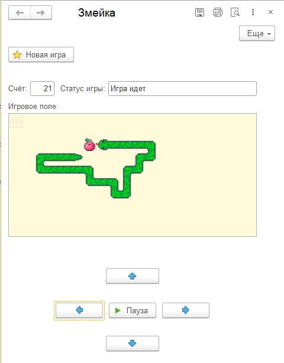

# Змейка на 1С

Небольшой учебный проект — классическая игра «Змейка»,
реализованная на платформе 1С:Предприятие.

Проект создавался как эксперимент с возможностями 1С,
а не как прикладное бизнес-решение.

## Что реализовано

- автоматическое движение змейки;
- управление направлением;
- пауза и новая игра;
- случайное появление еды;
- рост змейки после еды;
- подсчёт очков;
- столкновение со стенами и собственным телом;
- отображение игрового поля через табличный документ;
- собственные пиксельные спрайты головы, тела, поворотов,
  хвоста и еды.

## Что я изучила в процессе

В проекте я попрактиковалась в:

- управляемых формах;
- процедурах и функциях;
- массивах и структурах;
- циклах и условиях;
- клиентском и серверном коде;
- обработчиках ожидания;
- табличном документе и макетах;
- работе с изображениями;
- хранении состояния игры.

## Запуск

Открыть `Snake.epf` в 1С:Предприятии и запустить внешнюю обработку.

Проект выполнен в учебной версии 1С.
